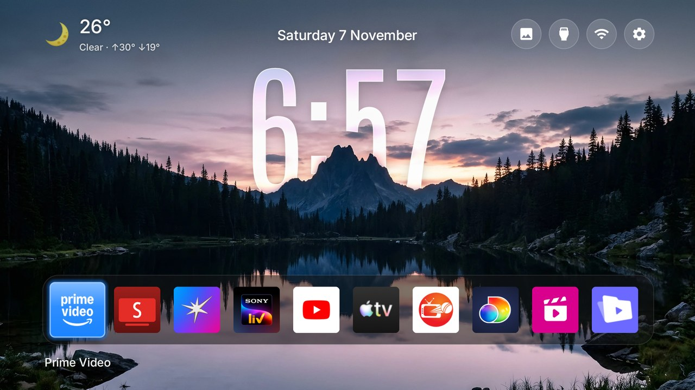

# Glass-clock home: couch-tv's Night look on the Clean Your TV launcher



This fork adds a home screen in the style of [couch-tv](https://github.com/Seagey/couch-tv)'s Night look to the
[Clean Your TV](https://github.com/Gathin23/cleanyourtv) launcher:

- **A big glass clock with depth.** Tall Antonio digits filled with a frosted copy of the picture behind them, with
  a thin light rim, a soft sheen and a soft shadow. The picture's scenery (a mountain, a skyline, a jet) is cut out
  and drawn *over* the clock, so the digits sit behind it.
- **The weather** at the top left (now, today's high and low, the chance of rain), from a tiny add-on that asks
  [Open-Meteo](https://open-meteo.com) only while Home is on screen. The launcher itself stays offline.
- **Pictures that follow the weather and the time of day**: morning, evening and night scenes, and cloudy, rainy and
  foggy ones in daylight, from the weather add-on.
- **A wallpaper picker** on the TV: a round picture button next to Inputs, Wi-Fi and Settings opens every scene as a
  thumbnail, with *Automatic* (weather and time) first.
- **A compact app row**: square, full-bleed app icons in one slim band; the chosen app grows, glows in its own colour
  and shows its name under the band.

Everything is a theme switch, off by default, so the launcher behaves as before until a theme turns it on.
Tested on a Xiaomi MiTV-MOOR2 (Google TV, Android 11, 1080p).

## What you need

- An Android TV or Google TV that the Clean Your TV launcher already runs on (the main [README](../README.md) gets you
  there: network debugging on, `tools/venv` set up, the launcher installed as Home).
- A computer with JDK 17 and the Android SDK (platform 34, build-tools 34.0.0), as for building the launcher.

## 1. Build and install this launcher

From the repo root, with your TV's address:

```sh
TV_HOST=<tv ip> launcher/build-and-install.sh
```

(PowerShell: `launcher\build-and-install.ps1 -TvHost <tv ip>`.) This launcher is larger than upstream's 576 KB size
gate, mostly because of the two fonts; that gate is upstream's rule for contributions, not a limit of the TV.

## 2. Build and install the weather add-on

Say where the weather is for, in your own `~/.gradle/gradle.properties` (outside the repo, so it never gets
committed):

```properties
tvweather.place=Lisbon
tvweather.latitude=38.72
tvweather.longitude=-9.14
```

Then build it and install it:

```sh
cd addons/tv-weather && ./gradlew --no-daemon assembleRelease && cd ../..
tools/venv/bin/python -I tools/b64push.py addons/tv-weather/app/build/outputs/apk/release/app-release.apk /data/local/tmp/tvweather.apk
TV_HOST=<tv ip> tools/venv/bin/python -I tools/tv.py 'pm install -r /data/local/tmp/tvweather.apk; rm -f /data/local/tmp/tvweather.apk'
```

(On Windows Git Bash, use `tools/venv/Scripts/python`, and put `MSYS_NO_PATHCONV=1` in front of commands that name a
path on the TV.) Without the add-on, the theme still works; the weather corner stays empty and the pictures follow
the time of day only.

## 3. Push the theme

Copy the theme somewhere outside the checkout and add your own settings to its `config.json`:

```sh
cp -r fork/glass-depth ~/my-tv-theme
```

| Key | Example | What it does |
|---|---|---|
| `dock_apps` | `["com.netflix.ninja", "com.google.android.youtube.tv"]` | The apps at the start of the row, in order |
| `hidden_apps` | `["com.mediatek.wwtv.tvcenter"]` | Apps left out of the row |
| `columns` | `10` | Icons across the screen (up to 12 with `square_tiles`) |

For the morning, evening and night pictures to follow your own sunrise and sunset, set `latitude` and
`longitude` in `launcher/app/src/main/res/values/config.xml` before building (a build setting, see
[docs/sky.md](sky.md)); without them the day turns at 07:00 and 18:30.

Then push it:

```sh
TV_HOST=<tv ip> tools/theme.sh ~/my-tv-theme
```

`tools/theme.sh --reset` takes the TV back to the plain launcher look.

## 4. On the TV

- **Change the picture**: Up to the round buttons, the picture button first, OK. Pick a scene, or *Automatic*.
- **Automatic**: at night a night scene; in daylight a cloudy, rainy or foggy one when the weather says so; otherwise
  a morning or evening scene. A picture changes every 30 minutes within its group.

## The theme keys this adds

| Key | Type | Meaning |
|---|---|---|
| `big_clock` | bool | The glass clock in the middle of Home, the date above it; the weather, the date and the round buttons share one line at the top |
| `wallpaper_styles` | object | Per picture: `{"01-night.jpg": {"clock_y": 0, "clock_x": "left", "clock_scale": 1.15, "text": "dark"}}`; `clock_y` moves the clock down in 1080p pixels, `text: dark` gives smoky digits and dark text over a pale sky |
| `wallpaper_drop` | 0 to 30 | Zoom the picture from its top edge by this many percent, to move its skyline down |
| `weather` | package | The weather add-on (`app.tvweather`) whose reading Home shows |
| `wallpaper_moods` | object | Adds `cloudy`, `rain` and `fog` groups next to `morning`, `evening` and `night`; in daylight the weather's group wins |
| `square_tiles` | bool | Square, full-bleed icon tiles (with `uniform_tiles`); `columns` may go up to 12 |
| `focus_names` | bool | Only the chosen app's name, under it |

## Adding your own pictures

A picture is up to three files in the theme's `wallpapers/` folder, plus a line in `captions.txt` for its name in
the picker, a `wallpaper_styles` entry and a place in `wallpaper_moods`:

| File | What it is |
|---|---|
| `NAME.jpg` | The picture, exactly 1920x1080. Crop it from a bigger original so it stays sharp. |
| `NAME-fg.webp` | Optional: the scenery with the sky transparent, drawn over the clock. |
| `NAME-glass.jpg` | Optional: the picture blurred (radius 16) and brightened (x1.3, colour x1.25), the digits' fill. |

The clock looks best when the scenery's edge crosses the middle of the colon's lower dot, about 452 px from the top
on a 1080p screen with `clock_y` 0: frame the picture so its skyline lands there. Three ways to make the cut-out:

- **A landscape with a calm sky**: couch-tv's [`tv-home/tools/make-scene.py`](https://github.com/Seagey/couch-tv/blob/main/docs/MAKE-A-SCENE.md)
  `--depth`. If the sky runs down into the mountains in streaks, try `--step 4 --far 22 --spread 3 --fill 70`.
- **A subject in front of a busy background** (a plane, a person): [rembg](https://github.com/danielgatis/rembg)
  with the `isnet-general-use` model, run on your computer.
- **Forest against a blue and white sky**: a colour rule (green scenery, blue or white sky), taken from the top of
  each column down and smoothed.

Check every cut-out over magenta before it goes on the TV; a bad edge looks worse than no cut-out at all.

## Credits

- [Clean Your TV](https://github.com/Gathin23/cleanyourtv) by Gathin (MIT): the launcher, its tools and its themes.
  This repo is a fork of it.
- [couch-tv](https://github.com/Seagey/couch-tv) by Seagey (MIT): the Night look this recreates (the glass clock, its
  fonts, the cut-out depth), its scenes and `make-scene.py`. See [`licenses/couch-tv-LICENSE.txt`](../licenses/couch-tv-LICENSE.txt).
- Fonts: [Antonio](https://github.com/googlefonts/antonioFont) and [Inter](https://github.com/rsms/inter), SIL Open
  Font License 1.1 ([`licenses/`](../licenses/)).
- Pictures: see [`fork/glass-depth/CREDITS.md`](../fork/glass-depth/CREDITS.md).
- Weather data by [Open-Meteo.com](https://open-meteo.com) (CC BY 4.0).
